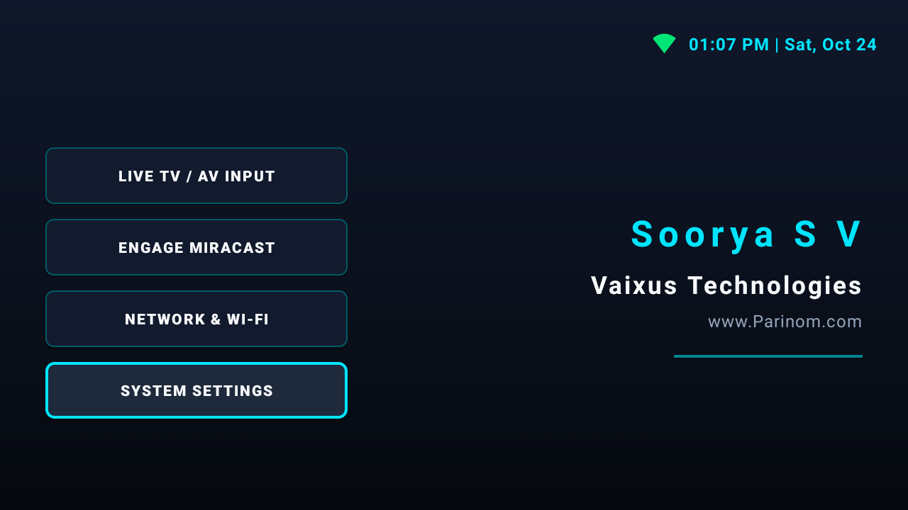

# Vaixus TV Launcher


An ultra-lightweight, high-performance home launcher specifically engineered for low-spec Android TV devices constrained by **1 GB RAM** running on **Android 9 (API Level 28)**, such as the Xiaomi Dangal board / MiTV-AXS00 platform.

Vaixus TV Launcher replaces bloated default launchers with an instantaneous, sci-fi-themed dashboard that uses less than **35 MB PSS memory**, eliminating UI redraws, launcher crashes, and frame drops.

---

## Core Features

<p align="center">
  
  
</p>
- **3-Second Animated Splash Screen**: A sleek, fullscreen intro overlay (`splashOverlay`) displaying *Vaixus Technologies* that smoothly fades out after 3000 ms, transitioning into the main dashboard and automatically focusing the primary action button.
- **D-Pad Optimized Dual-Column UI**: Uses `AppCompatButton` controls with `@drawable/btn_sci_fi_selector` and `app:backgroundTint="@null"` to avoid touch-mode focus bugs on TV remotes while offering glowing cyan focus outlines (`#00E5FF`).
- **Sci-Fi Live TextClock**: Real-time clock header styled in futuristic cyan displaying time and date formatted as `'hh:mm a | EEE, MMM d'`.
- **Live Network Status Callback**: Features an active `ConnectivityManager.NetworkCallback` that dynamically tints a top-bar indicator icon **Green** (`#00E676`) when internet is connected and **Red** (`#FF3D00`) when disconnected.
- **Direct Hardware Intent Routing**:
  - **Live TV / AV Input**: Multi-stage intent routing attempting `com.android.tv`, `com.xiaomi.mitv.tvplayer`, and `tv://channel` passthrough with exception handling.
  - **Miracast / SmartShare**: Direct launch for `com.xiaomi.mitv.smartshare` with seamless fallback to `android.settings.CAST_SETTINGS`.
  - **Wi-Fi & System Settings**: One-click shortcuts to `Settings.ACTION_WIFI_SETTINGS` and `Settings.ACTION_SETTINGS`.
- **Persistent Launcher State**: Overrides `OnBackPressedCallback` and declares `HOME`, `DEFAULT`, and `LEANBACK_LAUNCHER` categories to ensure the launcher remains active upon pressing the TV remote back button.

---

## System Optimization & ADB Debloat

To maximize available system RAM on 1 GB Android TV hardware, use the following PowerShell ADB commands to freeze heavy stock launchers, telemetry services, and speed up system animations:

```powershell
# 1. Connect to Android TV via ADB
adb connect <TV_IP_ADDRESS>:5555

# 2. Disable heavy default launchers and Xiaomi/Google background bloatware
adb shell pm disable-user --user 0 com.google.android.tvlauncher
adb shell pm disable-user --user 0 com.google.android.tvrecommendations
adb shell pm disable-user --user 0 com.mitv.tvhome
adb shell pm disable-user --user 0 com.xiaomi.mitv.advertise
adb shell pm disable-user --user 0 com.miui.tv.analytics
adb shell pm disable-user --user 0 com.xiaomi.statistic

# 3. Optimize animation scale settings for snappy UI response
adb shell settings put global window_animation_scale 0.5
adb shell settings put global transition_animation_scale 0.5
adb shell settings put global animator_duration_scale 0.5

# 4. Verify Vaixus TV Launcher memory consumption (<35 MB PSS)
adb shell dumpsys meminfo com.vaixus.tvlauncher
```

---

## Installation & Deployment

### Wireless ADB Setup via Wi-Fi Hotspot

1. **Enable Developer Mode**:
   - On your Android TV, navigate to **Settings > Device Preferences > About**.
   - Click **Build** 7 times until Developer Options are enabled.
2. **Enable ADB Debugging**:
   - Navigate to **Settings > Device Preferences > Developer Options** and enable **ADB Debugging**.
3. **Connect to Same Network**:
   - Ensure your workstation and Android TV are connected to the same Wi-Fi network or mobile hotspot.
   - Find your TV's IP address under **Settings > Network & Internet**.
4. **Connect via Terminal**:
   ```bash
   adb connect <TV_IP_ADDRESS>:5555
   ```
5. **Deploy from Android Studio**:
   - Select `<TV_IP_ADDRESS>:5555` as the target deployment device in Android Studio and click **Run (`Shift + F10`)**.
   - Or build and install directly via Gradle:
     ```bash
     ./gradlew assembleDebug
     adb install -r app/build/outputs/apk/debug/app-debug.apk
     ```

---

## Project Documentation

* [Developer & Architecture Guide](docs/DEVELOPMENT.md) — Technical stack, architectural decisions, and Wireless ADB workflows.
* [Testing & QA Strategy](docs/TESTING.md) — Emulator UI focus testing, hardware intent checklists, and RAM verification.
* [Project Changelog](CHANGELOG.md) — Release history and version updates.

---

## Credits & License

**Authored by**: Soorya S V | **Vaixus Technologies** | [www.parinom.com](http://www.parinom.com)

Licensed under the **MIT License**. See `LICENSE` for details.
